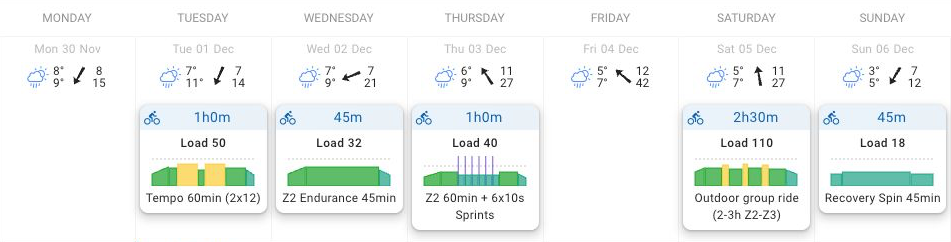
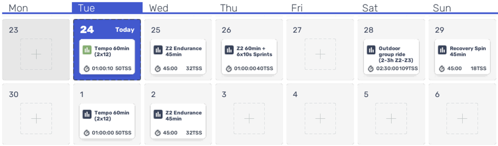
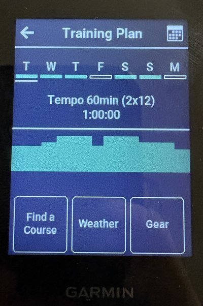
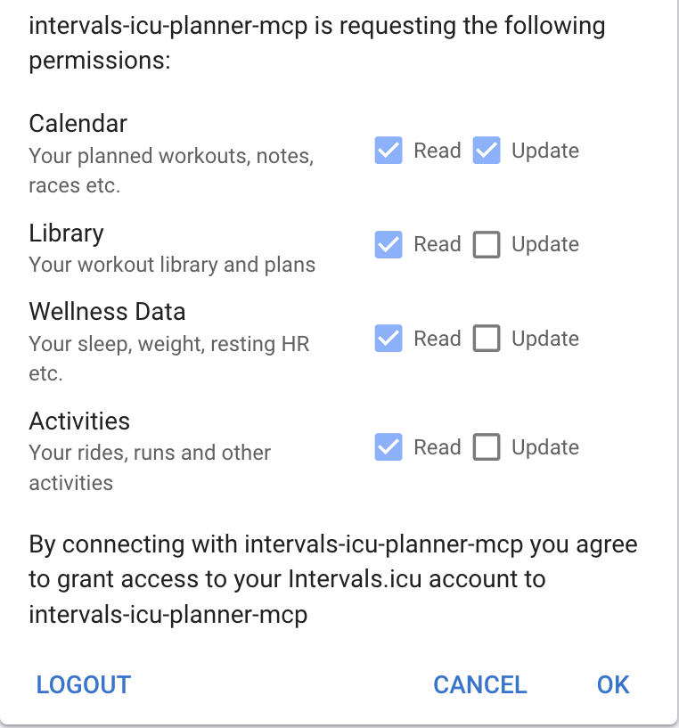

# intervals-icu-planner-mcp

[](https://pypi.org/project/intervals-icu-planner-mcp/)
[](https://github.com/gustavosoares/intervals-icu-planner-mcp/actions/workflows/tests.yml)
[](LICENSE)

[](https://modelcontextprotocol.io)

**Plan a whole training block with Claude and put it on your
[intervals.icu](https://intervals.icu) calendar in one go, safely.**



<!-- TODO: add a short GIF of Claude showing a dry-run diff and applying it -->

## What it's for

If you train with a plan, you know the routine: every week you open the
calendar and drag in Tuesday's intervals, Wednesday's endurance ride,
Saturday's long ride… for twelve weeks. Then you get sick, and all of it
has to move.

With this, you ask Claude in plain words.

**Build a plan for your goal and put it on your calendar**

> *"I'm riding a 100 km sportive on 14 June. I have about 6 hours a week:
> short indoor rides Tuesday to Thursday, a long ride at the weekend. Build me
> a plan and put it on my calendar."*

Or, if you already have one: *"Put my 12-week winter base plan on my
calendar, starting next Monday."*

Claude shows you exactly what it's going to add, and nothing changes until
you say yes. Then the whole block lands on your intervals.icu calendar, and
from there each day's workout shows up in **Zwift, MyWhoosh or on your
Garmin**, ready to ride.

<p align="center">
  
  <br>
  
</p>

**See how you did**

- *"I raced on Sunday. How did I do?"*
- *"Review my rides this week. How did they go compared to the plan?"*

Claude reads your completed rides from intervals.icu (time, power, heart
rate, training load) and compares them with what was planned and with your
fitness. Rides that reached intervals.icu through Strava can't be read
([why](docs/training-apps.md#reading-your-activities)).

**Adjust when life gets in the way**

- *"Check my fitness. Should I rest, or change the plan?"*
- *"I was sick this week, push the rest of the plan back a week."*
- *"Move Thursday's sprints to Friday."*

Claude looks at your fitness, fatigue and form, suggests what to change, and
shows you the new calendar before changing anything.

It only ever touches the workouts it put there. Your races, notes and
anything you added by hand are left alone.

<details>
<summary>What's an MCP server?</summary>

[MCP](https://modelcontextprotocol.io) is how apps like Claude get new
abilities. This project is a small program that runs on your computer and
gives Claude a few safe tools for your intervals.icu calendar. Claude
decides when to use them, and asks you before writing anything.
</details>

## Why plan-level

General intervals.icu MCP servers expose the API one event at a time: create
an event, delete an event, list activities. That works for a single workout.
For a 12-week block it means dozens of separate writes, with nothing tying
them together and nothing that shows you what will change first.

This server works on **whole plans**:

- **One file, one plan.** You describe the block once in a `plan.yaml`
  (week templates, per-week changes, recovery weeks) plus `.zwo` workouts.
  Edit the file and push again: events are updated in place, never duplicated.
- **Diff before write.** Every write tool is a dry run by default and returns
  a per-date diff (`+` new, `~` updated, `=` unchanged, `!` stale).
- **A plan only touches its own events.** Each event carries a uid,
  `planner-<plan_id>-w<NN>-<day>`, and the server never modifies an event
  without one.
- **Reversible.** `delete_plan` removes exactly the events a plan created, and
  `push_plan` with `prune=true` removes the ones you took out of the plan.

It also reads your fitness (CTL / ATL / Form) and completed activities, so
you can ask Claude how the block is going.

## Quick start

### Claude Desktop: one-click install

1. **Download `intervals-icu-planner-<version>.mcpb`** from the
   [latest release](https://github.com/gustavosoares/intervals-icu-planner-mcp/releases/latest)
   and double-click it (or drag it into Claude Desktop → Settings → Extensions).
2. **Click Install.** Leave the API key empty. Optionally, pick a **plans
   folder**: the planner then refuses to read or edit plans anywhere else.
3. **Ask Claude to "connect to intervals.icu".** intervals.icu opens in your
   browser: sign in and click **OK**. That's it; no API key to copy. The
   access is saved in your system keychain.

   

> **About the install warning.** Claude Desktop says the extension gets
> "access to everything on your computer". It shows that for every extension
> that isn't in its reviewed directory, because extensions run as ordinary
> programs on your computer, as any MCP server does. Here is what this one
> actually does:
>
> - It talks only to intervals.icu (your calendar, workout library, fitness
>   and rides), over HTTPS, with the access you approved. Nothing goes to the author or
>   anyone else ([privacy](docs/privacy.md)).
> - It reads only the plan files you point it at, and edits only the
>   `plan.yaml` you ask it to move or shift. With a plans folder set, it
>   refuses anything outside that folder.
> - It's open source: the extension installs this repository's
>   [PyPI release](https://pypi.org/project/intervals-icu-planner-mcp/), and
>   the safety rules are [tested](docs/safety.md).

### Claude Code, or a manual setup

1. **Install [uv](https://docs.astral.sh/uv/)**, then add the server.

   **Claude Desktop** (Settings → Developer → Edit Config):

   ```json
   {
     "mcpServers": {
       "intervals-icu-planner": {
         "command": "uvx",
         "args": ["intervals-icu-planner-mcp"]
       }
     }
   }
   ```

   **Claude Code**:

   ```sh
   claude mcp add -s user intervals-icu-planner -- uvx intervals-icu-planner-mcp
   ```

2. **Restart Claude** and check the `intervals-icu-planner` tools are listed.
   If they aren't, see [docs/troubleshooting.md](docs/troubleshooting.md).
3. **Ask Claude to "connect to intervals.icu"** and approve in your browser
   (or run `uvx --from intervals-icu-planner-mcp intervals-icu-planner login`).
   Prefer an API key? See [docs/setup.md](docs/setup.md).

### Other AI apps

It's a standard MCP server, so any app that can run a local (stdio) MCP server
should work, such as Cursor, VS Code with GitHub Copilot, Windsurf or Zed. Add it in
that app's MCP settings with the command `uvx intervals-icu-planner-mcp`, then ask
it to connect to intervals.icu. Only Claude Desktop and Claude Code are tested so
far; reports of other apps are welcome in the
[issues](https://github.com/gustavosoares/intervals-icu-planner-mcp/issues).

ChatGPT isn't supported: it only connects to remote MCP servers, and this one runs
on your computer.

## Try it

Clone the repo for the [example plan](examples/winter-base-12wk/) (12 weeks
of winter base, all targets in % of FTP), then paste this into Claude:

> Push `/path/to/intervals-icu-planner-mcp/examples/winter-base-12wk/plan.yaml`
> starting next Monday. Show me the dry run first and don't apply anything
> until I say so.

Claude calls `push_plan` as a dry run and shows you the diff:

```
Winter Base 12 Weeks (winterbase): 12 weeks, 2026-11-30 -> 2027-02-21

Week 1, 2026-11-30
  + 2026-12-01 Tue  WORKOUT  W09_Tempo_60_2x12.zwo
  + 2026-12-02 Wed  WORKOUT  W10_Z2_45.zwo
  + 2026-12-03 Thu  WORKOUT  W04_Z2_60_Neuromuscular_Sprints.zwo
  + 2026-12-05 Sat  WORKOUT  W12_Group_Ride_2h30_Placeholder.zwo
  + 2026-12-06 Sun  WORKOUT  W01_Recovery_Spin_45.zwo
...
60 new, 0 updated, 0 unchanged, 0 stale.
Dry run: nothing was written. Run again with dry_run=false to apply.
```

Say "apply it" and the plan lands on your calendar, as in the screenshot
above. More things to ask:

- **Plan:**
  - *"What's planned for next week?"*
  - *"What's in my workout library?"*
- **Review:**
  - *"Review my race on Sunday: power, heart rate and load against my
    fitness. What went well and what should I work on?"*
  - *"How did last week go? Compare what was planned with what I rode."*
- **Adjust:**
  - *"Check my fitness and form over the last 6 weeks. Am I fresh enough for
    next week's plan, or should I rest or ease it off?"*
  - *"Move week 3's Thursday session to Friday."*
  - *"I was sick, push the rest of the plan back a week."*
  - *"Remove the winterbase plan from my calendar."*

Anything that writes shows you a dry run first and waits for your OK.

### Building a plan from your goals

Claude learns the plan format from the server's `plan_guide` tool, then
writes the plan as files (a `plan.yaml` and `.zwo` workouts) and pushes them.
So it needs somewhere to save them: Claude Code can do that directly, and in
Claude Desktop, add a filesystem extension that can write to a folder of your
choice.

> I'm riding a 100 km sportive on 14 June and have about 6 hours a week:
> short indoor rides Tuesday to Thursday, a long ride at the weekend. Build me
> a plan in `~/training/sportive`, then do a dry-run push and show me the diff.

Claude will usually ask about your goal and week first. Workouts use % of
FTP, so set your FTP in intervals.icu (or your training app).

Every plan and workout is checked before anything is sent, so a mistake in
what Claude wrote is reported, not uploaded. Your answers about fitness and
when to rest are Claude's suggestions from your intervals.icu numbers, not a
coach's or doctor's advice.

## Tools

| Tool | What it does | Writes? |
|---|---|---|
| `push_plan(plan_yaml, start_date?, dry_run=true, prune=false)` | Validate a plan, diff it against the calendar, upsert new and updated events; with `prune=true` also delete the plan's stale events | only with `dry_run=false` |
| `get_planned(oldest, newest, plan_id?)` | List planned events; optionally only one plan's | no |
| `delete_plan(plan_id, dry_run=true, oldest?, newest?)` | Remove every event the plan created, nothing else | only with `dry_run=false` |
| `get_fitness(oldest, newest)` | CTL, ATL, Form (TSB = CTL − ATL) and Form as % of CTL, per day | no |
| `get_activities(oldest, newest)` | Completed activities: time, distance, load, avg/normalized power, IF, HR | no |
| `move_workout(plan_yaml, week, day, to_day, to_week?, swap=false, dry_run=true)` | Move one session to another day: edits plan.yaml, then syncs with prune | only with `dry_run=false` |
| `shift_plan(plan_yaml, weeks=1, from_week?, dry_run=true)` | Push the rest of the plan back N weeks (illness, travel); past weeks stay | only with `dry_run=false` |
| `list_library(folder?)` | Your intervals.icu workout library: folders and plans with their workouts | no |
| `plan_guide()` | How to write a plan: the plan.yaml format and schema, the .zwo rules, examples and steps. Claude reads it before writing a plan | no |

`plan_yaml` is a path to the file. Everything also works from the
command line: see [docs/cli.md](docs/cli.md).

## Writing your own plan

```yaml
# yaml-language-server: $schema=https://raw.githubusercontent.com/gustavosoares/intervals-icu-planner-mcp/main/schemas/plan.schema.json
id: myblock
name: My 3-week block
start: 2026-11-30            # a Monday
templates:
  build:
    tue: W09_Tempo_60_2x12.zwo
    thu: W04_Z2_60_Neuromuscular_Sprints.zwo
    sat: { note: Long outdoor ride }
weeks:
  - { template: build }
  - { template: build, overrides: { thu: W06_Tempo_3x10.zwo } }
  - { template: build, overrides: { thu: null }, recovery: true }
```

Workouts are `.zwo` files in a `workouts/` folder next to the plan. The first
line gives you validation and autocomplete in editors with the YAML language
server. The full reference (overrides, notes, re-pushing, pruning, moving and
shifting) is in [docs/plan-reference.md](docs/plan-reference.md).

## Safety

This writes to your real training calendar, so it's built to be hard to misuse:

- **Dry run first**: every write returns a diff and waits for your OK.
- **Only its own events**: nothing without the plan's exact uid is touched or even shown.
- **Validate before upload**: the plan and every `.zwo` are checked, and one error means nothing is sent.
- **The API key stays private**: never logged, printed or put in error messages.
- **Careful file edits**: moves and shifts are previewed, never touch the past, and are written atomically.

Details in [docs/safety.md](docs/safety.md).

## Documentation

- [Setup](docs/setup.md): API key, the macOS Keychain, Claude Desktop and Claude Code
- [plan.yaml reference](docs/plan-reference.md): fields, uids, pruning, moving and shifting, the example plan
- [Training apps and activities](docs/training-apps.md): Zwift, MyWhoosh, Garmin, ERG mode, Strava limits
- [CLI](docs/cli.md): every command
- [Safety design](docs/safety.md)
- [Privacy](docs/privacy.md): what data goes where (nowhere but intervals.icu and your AI app)
- [How it works](docs/how-it-works.md): architecture and intervals.icu API notes
- [Troubleshooting](docs/troubleshooting.md)
- [Contributing](CONTRIBUTING.md) and [Changelog](CHANGELOG.md)

## Roadmap

- Activity analysis: planned vs completed, compliance per week
- OAuth and the streamable HTTP transport, for claude.ai custom connectors
- Writing to the workout library (import or remove workouts in one dedicated folder)

## A note on AI assistance

This project is built with help from AI coding tools, which speed up writing code, tests
and documentation. Every change is reviewed and tested by a human maintainer before it's
merged, and the maintainer is responsible for what ships, including the safety rules above.

## License

MIT, see [LICENSE](LICENSE).
