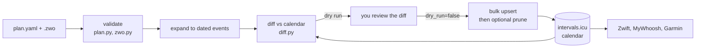

# How it works

[← Back to README](../README.md)

The technical side: how the code is laid out, how it talks to intervals.icu,
and the API details that shaped the design. You don't need any of this to
use the server.

## Layout

```
src/intervals_icu_planner_mcp/
  client.py    HTTP client (httpx). Knows nothing about MCP or plans
  zwo.py       .zwo parsing and validation
  plan.py      pydantic models (the source of the JSON Schema), uids, expansion into events
  diff.py      plan vs calendar diff and its rendering
  edit.py      round-trip edits of plan.yaml (ruamel.yaml): move a session, shift weeks
  planner.py   the operations, shared by both front ends
  server.py    MCP tools: thin wrappers over planner
  cli.py       argparse front end: thin wrapper over planner
  config.py    API key lookup
```



Both front ends (MCP and CLI) call the same functions in `planner.py`, so
they behave the same way.

## The intervals.icu API

Checked against the [OpenAPI spec](https://intervals.icu/api/v1/docs) and a
real account.

- **Auth** is HTTP Basic with user `API_KEY` and the key as password.
  Athlete id `0` means "the athlete who owns the key".
- **Writes** go to `POST /api/v1/athlete/0/events/bulk?upsert=true`. Each
  workout's `.zwo` is sent as-is in `file_contents`, with its `filename`.
- **Deletes** go to `PUT /events/bulk-delete` with `[{"id": n}]`. Each event
  is checked against the plan's uid pattern right before the request.
- **Reads**: `GET /events` for the calendar, `GET /wellness` for CTL and ATL
  (Form % = (CTL − ATL) / CTL × 100), `GET /activities` for completed rides.

### Where the uid lives

Each event gets a plan uid, `planner-<plan_id>-w<NN>-<day>`. It's stored in
the event's **`external_id`**, not its `uid`: intervals.icu keeps the
`external_id` you send, but replaces `uid` with its own random UUID. An early
version read `uid` first, and a freshly pushed plan couldn't see its own
events. There's a regression test for it in `tests/test_diff.py`.

The upsert matches existing events on `external_id`, so pushing an edited
plan updates events in place (same event ids, no duplicates), even when an
event changes from a note to a workout.

### Why workouts are compared by name and duration

`GET /events` returns the parsed workout, but not the original `.zwo`. So the
diff can't see a change inside a workout that keeps its name and total
length. Rename the workout to force an update. Descriptions are only compared
for notes, because intervals.icu may rewrite a workout's description.

### Strava-imported activities

Activities that reached intervals.icu through Strava come back as empty stubs
(`source: "STRAVA"`), because of Strava's API terms.

## Editing plan.yaml without wrecking it

`move_workout` and `shift_plan` edit your file, so they try hard to keep it
as you wrote it. ruamel.yaml can't reproduce every layout (for example, it
drops the spaces in `{ flow: maps }`), so the edit keeps every line it didn't
change verbatim from the original, and only changed lines come from ruamel.
The new file is validated before it's written, written atomically, and only
if it hasn't changed since it was read. Then the calendar is synced with
prune.

## Development

```sh
python -m venv .venv && .venv/bin/pip install -e ".[dev]"
.venv/bin/pytest -q          # HTTP is mocked with respx; no network
.venv/bin/ruff check . && .venv/bin/ruff format --check .
.venv/bin/mypy               # strict
```

After changing the plan models, regenerate the schema with
`intervals-icu-planner schema > schemas/plan.schema.json` (a test fails if it
drifts). See [CONTRIBUTING.md](../CONTRIBUTING.md) for the ground rules.
